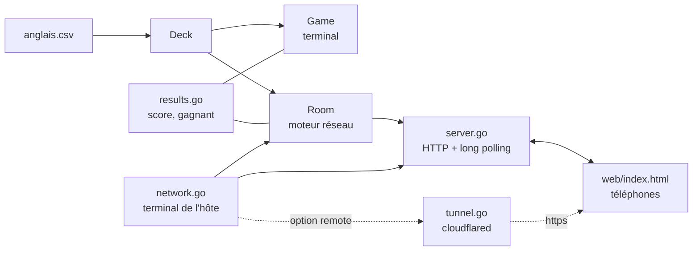
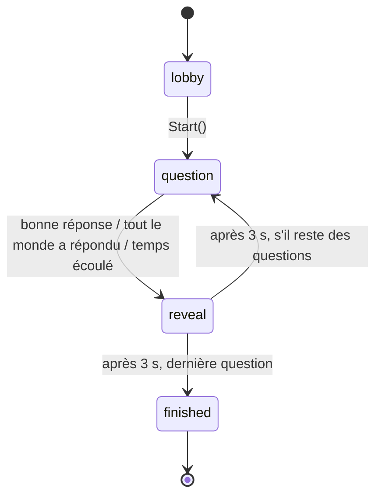
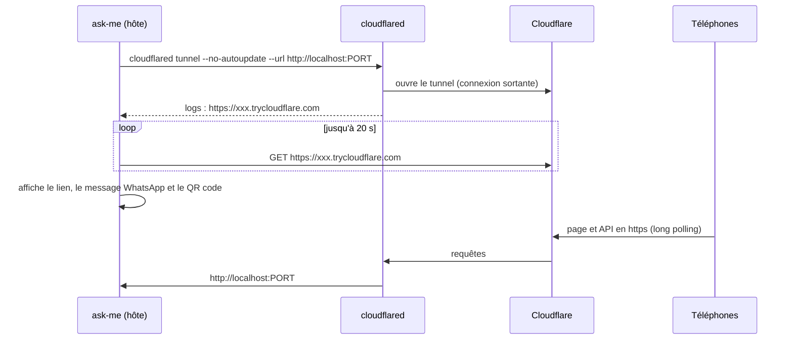

# Documentation technique

Ce document décrit le fonctionnement interne d'ask-me. Pour l'utilisation, voir le [README](../README.md).

## Vue d'ensemble

ask-me est un unique binaire Go, sans base de données ni fichier de configuration. Il a trois modes d'exécution, choisis dans [main.go](../main.go) :

- **terminal** (par défaut) : les joueurs se passent le clavier, à tour de rôle ;
- **réseau local** (`-reseau`) : le binaire devient un serveur HTTP sur le réseau local, et les joueurs jouent depuis le navigateur de leur téléphone ;
- **à distance** (`-remote`) : le même serveur, rendu accessible depuis Internet par un tunnel Cloudflare lancé par le jeu.



## Fichiers

| Fichier | Rôle |
|---|---|
| [main.go](../main.go) | options de la ligne de commande, chargement du CSV, choix du mode |
| [deck.go](../deck.go) | `Deck` : lecture et validation du CSV, tirage des questions (`RandomQuestion`, `Clue`, `Answer`) |
| [results.go](../results.go) | `Player`, score, gagnant, affichage des résultats — communs aux deux modes |
| [game.go](../game.go) | `Game` : partie dans le terminal |
| [room.go](../room.go) | `Room` : moteur de la partie en réseau (salon, modes, délais, diffusion) |
| [snapshot.go](../snapshot.go) | `Snapshot` : état de la partie envoyé aux téléphones |
| [server.go](../server.go) | serveur HTTP : page du jeu et API JSON (état transmis par long polling) |
| [network.go](../network.go) | côté terminal de l'hôte : choix du mode, adresse IP, invitation, QR code, résultats |
| [tunnel.go](../tunnel.go) | `-remote` : lancement de `cloudflared`, lecture de l'adresse publique, attente qu'elle réponde |
| [web/index.html](../web/index.html) | page jouée sur les téléphones (HTML, CSS et JS sans dépendance), intégrée au binaire par `embed` |

## Données : le deck

Le fichier CSV (séparateur `;`) est lu par `ParseDeck` :

- la première ligne utile donne les **thèmes** (colonnes) ;
- chaque ligne suivante est un **sujet** ; une ligne plus courte que l'en-tête est ignorée avec un log ;
- les lignes vides et les commentaires `#` sont ignorés, les espaces autour des valeurs supprimés ;
- le deck doit avoir au moins 2 thèmes et 1 sujet, sinon `ParseDeck` renvoie une erreur.

Une `Question` est un triplet d'indices `{Subject, Given, Asked}`. `RandomQuestion` tire un sujet et deux thèmes distincts sans boucle de rejet : on tire `asked` parmi `n-1` valeurs et on saute `given`.

La réponse est correcte si elle est **strictement égale** à la valeur attendue, après suppression des espaces autour de la saisie (casse et accents comptent).

## Mode terminal : `Game`

`Game.Run` enchaîne `nbTurns` tours ; à chaque tour, chaque joueur reçoit une question. Les entrées/sorties passent par des champs remplaçables (`in *bufio.Scanner`, `out io.Writer`, `rng *rand.Rand`) : un seul `Scanner` est partagé pour toute la partie, ce qui évite de perdre des lignes quand l'entrée est redirigée.

## Mode réseau : `Room`

### Machine à états



| Phase | Ce qui se passe |
|---|---|
| `lobby` | `Join(name)` ajoute un joueur et renvoie son identifiant secret |
| `question` | une question attend des réponses pendant `questionTime` (30 s) |
| `reveal` | la réponse et celui qui l'a trouvée sont affichés pendant `revealTime` (3 s) |
| `finished` | le gagnant et les résultats sont affichés ; le serveur reste ouvert pour que les téléphones les voient |

### Règles par mode

| | Chacun son tour (`ModeTurns`) | Le plus rapide (`ModeRace`) |
|---|---|---|
| Qui répond | uniquement le joueur dont c'est le tour (ordre d'arrivée) | tout le monde, une seule tentative par question |
| Nombre de questions | `n × nombre de joueurs` | `n` |
| Fin de la question | dès la réponse du joueur | première bonne réponse, ou tout le monde a répondu |
| Mauvaise réponse | échec | échec, plus de tentative sur cette question |
| Temps écoulé | échec pour le joueur dont c'est le tour | aucune pénalité |

Le gagnant est le joueur avec le plus de réussites (le premier inscrit en cas d'égalité) ; le score est le pourcentage de réussites (`results.go`).

### Concurrence et temps

- Toutes les méthodes publiques de `Room` prennent un `sync.Mutex` ; les méthodes `askQuestion`, `endQuestion` et `snapshot` supposent le verrou déjà pris.
- Les délais sont programmés par `r.schedule(d, f)` (par défaut `time.AfterFunc`). Chaque callback capture le numéro de la question (`round`) et ne fait rien si la partie a avancé entre-temps : un minuteur périmé ne peut pas terminer la question suivante.
- **Diffusion** : `Subscribe()` renvoie un canal de capacité 1 qui reçoit immédiatement l'état courant. À chaque changement, `broadcast()` vide l'éventuel état non lu puis envoie le nouveau : un abonné lent ne bloque jamais la partie et reçoit toujours l'état le plus récent.
- **Version** : `broadcast()` incrémente aussi `version`, envoyée dans chaque `Snapshot`. `WaitChange(ctx, after)` s'abonne et rend l'état dès que sa version est différente de `after` (ou à l'expiration de `ctx`) : c'est la base du long polling. Comme la version ne fait que croître, un téléphone qui connaît une version plus grande (celle d'une partie précédente) reçoit l'état courant tout de suite.

### Ce que voient les joueurs : `Snapshot`

L'état est le même pour tous les joueurs ; chaque téléphone sait qui il est grâce au prénom renvoyé à l'inscription. Pendant une question, le snapshot ne contient **jamais** la réponse attendue (elle n'apparaît que dans `reveal`).

```json
{
  "game": "07c395c370c41458e3638879a811b897",
  "version": 12,
  "phase": "question",
  "mode": "Le plus rapide",
  "players": [
    {"name": "Léa", "successes": 1, "failures": 0, "score": 100},
    {"name": "Tom", "successes": 0, "failures": 1, "score": 0}
  ],
  "question": {
    "number": 2, "total": 5,
    "givenTheme": "la base verbale", "clue": "hold", "askedTheme": "la traduction",
    "turn": "",
    "answered": ["Tom"],
    "deadline": 1791124297266,
    "duration": 30000
  },
  "now": 1791124267851
}
```

| Champ | Description |
|---|---|
| `game` | identifiant aléatoire de la partie : le téléphone oublie son inscription s'il change |
| `version` | numéro de l'état, incrémenté à chaque changement ; le téléphone le renvoie dans `GET /api/state?after=` |
| `turn` | en mode « chacun son tour », le joueur qui doit répondre |
| `answered` | joueurs ayant déjà répondu à la question en cours |
| `deadline`, `duration` | fin de la question (ms Unix) et durée totale, pour le compte à rebours |
| `now` | heure du serveur, pour corriger le décalage d'horloge des téléphones |
| `reveal` | `{"answer", "finder"}` pendant la phase `reveal` (`finder` vide si personne n'a trouvé) |
| `winner` | prénom du gagnant pendant la phase `finished` |

## API HTTP

Servie par `NewServer` ([server.go](../server.go)). Les messages d'erreur sont en français, car affichés tels quels aux joueurs.

| Méthode et route | Corps | Réponse |
|---|---|---|
| `GET /` | — | la page du jeu |
| `POST /api/join` | `{"name": "Léa"}` | `{"id": "<identifiant secret>"}` |
| `POST /api/answer` | `{"id": "…", "answer": "tenir"}` | `{"correct": true}` |
| `GET /api/state?after=<version>` | — | le `Snapshot` dès que sa version diffère de `after`, sinon le même après 25 s ; sans `after`, tout de suite |

Codes d'erreur : `400` avec `{"error": "…"}` (corps invalide, prénom vide, trop long ou déjà pris, partie commencée, pas ton tour, déjà répondu…), `404` pour un identifiant inconnu, `405` pour une mauvaise méthode. Les corps sont limités à 4 Ko.

`/api/state` fonctionne en **long polling** : le serveur garde la requête ouverte jusqu'au prochain changement de la partie (au plus 25 s, bien en dessous des 100 s après lesquelles Cloudflare coupe une requête sans réponse), puis le téléphone en relance aussitôt une autre. La réponse porte `Cache-Control: no-store` pour qu'aucun proxy ne la garde en cache. Ce sont des requêtes HTTP ordinaires, qui traversent n'importe quel proxy ou tunnel, contrairement aux Server-Sent Events, que les quick tunnels Cloudflare ne transmettent pas (voir [Jeu à distance](#jeu-à-distance--le-tunnel)).

L'identifiant renvoyé par `/api/join` est un secret aléatoire de 128 bits : seul le téléphone qui s'est inscrit peut répondre pour ce joueur.

## Page des téléphones

[web/index.html](../web/index.html) est un fichier unique sans dépendance :

- l'inscription `{game, id, name}` est gardée dans `localStorage` : un joueur qui recharge la page retrouve sa place, et une ancienne inscription est ignorée si l'identifiant `game` a changé ;
- une boucle `poll()` enchaîne les requêtes `GET /api/state?after=<dernière version>` ; en cas d'erreur, une bannière s'affiche et la boucle réessaie toutes les 2 s ;
- les sections sont masquées ou affichées, sans tout redessiner, pour ne pas effacer ce que le joueur est en train de taper quand un autre répond ;
- le champ de réponse désactive majuscule automatique, correcteur et suggestions (`autocapitalize`, `autocorrect`, `spellcheck`) ;
- le texte venant du serveur est toujours inséré avec `textContent` (pas d'injection HTML via un prénom).

## Côté terminal de l'hôte

`runNetworkGame` ([network.go](../network.go)) :

1. demande le mode (`chooseMode`) ;
2. écoute sur `-port` (4242 par défaut) : sur toutes les interfaces avec `-reseau`, seulement sur `127.0.0.1` avec `-remote` (seul `cloudflared` a besoin d'y accéder, et macOS ne demande pas d'autoriser les connexions entrantes) ;
3. construit le lien :
   - avec `-reseau`, à partir de l'adresse locale (`lanIP`) : d'abord l'interface utilisée pour sortir vers Internet (une « connexion » UDP n'envoie aucun paquet), sinon la première adresse IPv4 privée en préférant `192.168.x.x` (les `10.x.x.x` sont souvent des VPN) ;
   - avec `-remote`, à partir du tunnel (voir ci-dessous) ;
4. affiche le lien, le message WhatsApp et le QR code ([mdp/qrterminal](https://github.com/mdp/qrterminal)) ;
5. affiche les arrivées (`watchRoom`), lance la partie sur **Entrée**, puis affiche le gagnant et les résultats.

## Jeu à distance : le tunnel

Avec `-remote`, [tunnel.go](../tunnel.go) lance un [quick tunnel Cloudflare](https://developers.cloudflare.com/cloudflare-one/connections/connect-networks/do-more-with-tunnels/trycloudflare/) : une adresse publique en `https://…trycloudflare.com` qui renvoie vers le jeu, sans compte ni redirection de port sur la box.



1. `startTunnel` cherche `cloudflared` dans le `PATH` ; s'il manque, `ErrCloudflaredMissing` donne les commandes d'installation ;
2. `findTunnelURL` lit les logs de `cloudflared` (sur sa sortie d'erreur) jusqu'à trouver l'adresse publique, avec un délai maximum de 30 s ; ensuite les logs continuent d'être lus et jetés, pour que `cloudflared` ne bloque jamais en écrivant ;
3. `WaitReady` interroge l'adresse publique toutes les secondes, jusqu'à 20 s, car un nouveau tunnel met quelques secondes à répondre ; si ce n'est pas le cas, le lien est quand même affiché avec un avertissement. Le nom est résolu directement auprès du DNS de Cloudflare (`1.1.1.1`) : interroger le DNS du système avant que le nom existe lui ferait mémoriser l'échec, et l'hôte ne pourrait plus ouvrir le lien pendant un moment ;
4. `Stop` arrête `cloudflared` à la fin de la partie.

Le moteur, l'API et la page sont les mêmes qu'en réseau local. Deux points ont été découverts en testant avec un vrai tunnel :

- **Les quick tunnels ne transmettent pas les Server-Sent Events** ([limite documentée par Cloudflare](https://developers.cloudflare.com/cloudflare-one/connections/connect-networks/do-more-with-tunnels/trycloudflare/)) : les en-têtes arrivent, mais aucun événement. C'est pourquoi l'état passe par long polling (`/api/state`).
- **Cache DNS de l'hôte** : d'où la résolution par `1.1.1.1` dans `WaitReady` (étape 3 ci-dessus).

Les quick tunnels acceptent au plus 200 requêtes en cours : chaque joueur en garde une ouverte (le long polling) plus ses réponses, ce qui laisse de la marge pour une partie entre amis.

## Tests

```bash
go test -race ./...
```

| Fichier | Ce qui est testé |
|---|---|
| [deck_test.go](../deck_test.go) | lecture du CSV et cas d'erreur, cohérence de `anglais.csv`, tirage des questions |
| [game_test.go](../game_test.go) | partie terminal : vérification des réponses, ordre des tours |
| [results_test.go](../results_test.go) | score, gagnant, affichage des résultats |
| [room_test.go](../room_test.go) | inscription, deux modes de jeu, temps écoulé, minuteur périmé, réponse jamais divulguée, abonnements, attente d'un changement (`WaitChange`) |
| [server_test.go](../server_test.go) | page, API (succès et erreurs), long polling de bout en bout avec `httptest` (réponse immédiate, attente puis réponse au changement, expiration) |
| [network_test.go](../network_test.go) | choix du mode, choix de l'adresse IP, invitation (réseau local et à distance), suivi des arrivées |
| [tunnel_test.go](../tunnel_test.go) | lecture de l'adresse dans les logs, `cloudflared` absent, faux `cloudflared` (script shell qui imite ses logs et enregistre ses arguments), attente que le lien réponde |

Pour des tests rapides et déterministes :

- les générateurs aléatoires sont initialisés avec une graine fixe ;
- `Room.schedule` est remplacé par une **fausse horloge** (`fakeClock`) : `clock.elapse()` exécute les minuteurs en attente, sans attendre 30 s ;
- `echoDeck` a deux colonnes identiques, donc la bonne réponse est toujours connue (`x`).

La CI GitHub Actions ([.github/workflows/go.yml](../.github/workflows/go.yml)) compile et lance les tests avec Go 1.21 à chaque push et pull request sur `main`.

À la création d'une release GitHub, [.github/workflows/release.yaml](../.github/workflows/release.yaml) compile le binaire pour Linux, Windows et macOS (386, amd64, arm64) et publie une archive par cible avec `LICENSE`, `README.md` et `anglais.csv`, nécessaire au lancement du jeu.

## Dépendances

| Module | Usage |
|---|---|
| `github.com/fatih/color` | couleurs dans le terminal |
| `github.com/pkg/errors` | contexte sur les erreurs |
| `github.com/mdp/qrterminal/v3` | QR code dans le terminal |

Le serveur HTTP, le JSON, le long polling et l'intégration de la page utilisent uniquement la bibliothèque standard.

`-remote` utilise aussi le programme [cloudflared](https://github.com/cloudflare/cloudflared), à installer sur l'ordinateur de l'hôte. Ce n'est pas une dépendance Go : le jeu le lance comme une commande externe.

## Choix et limites

- **Navigateur plutôt qu'application** : rien à installer pour les joueurs, un lien suffit.
- **Long polling plutôt que SSE ou WebSocket** : la communication serveur → téléphones suffit (les réponses passent par un simple `POST`), c'est disponible dans la bibliothèque standard, et ce sont des requêtes HTTP ordinaires qui passent partout, y compris par les quick tunnels Cloudflare qui bloquent les SSE. Le coût, une requête par changement, est négligeable pour quelques joueurs.
- **Une partie par lancement** : pas de code de partie à saisir ; pour rejouer, relancer `./ask-me -reseau`.
- **Pas de persistance** : tout est en mémoire et disparaît à l'arrêt du programme.
- **Réseau local par défaut**, sans HTTPS ni authentification : avec `-reseau`, tous les appareils doivent être sur le même Wi-Fi, et certains réseaux (invités, établissements) isolent les appareils entre eux.
- **À distance par un tunnel plutôt qu'un hébergement** : `-remote` ne demande ni compte ni serveur, mais l'ordinateur de l'hôte doit rester allumé et le lien change à chaque partie. N'importe qui ayant le lien peut rejoindre le salon : l'adresse est aléatoire et n'existe que le temps de la partie. Les quick tunnels de Cloudflare sont prévus pour des tests et n'ont pas de garantie de disponibilité.
- **Latence** : en mode « le plus rapide », c'est la première réponse reçue par le serveur qui gagne ; à distance, une connexion lente désavantage légèrement.
- On ne peut pas quitter le salon une fois inscrit ; un joueur absent est pénalisé par le temps écoulé en mode « chacun son tour ».
